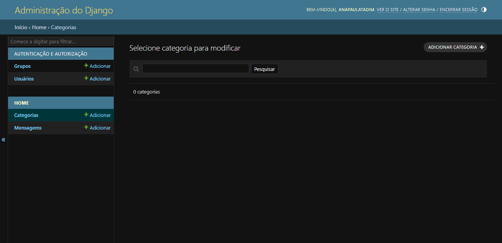
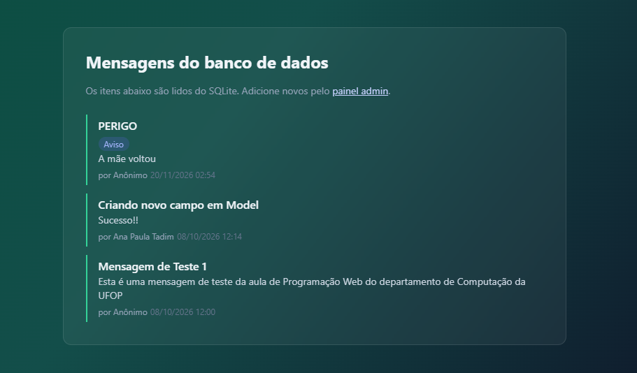

# Projeto Django — Ana Paula Tadim

**Nome:** Ana Paula dos Santos Tadim  
**Matrícula:** 23.2.4115  
**Curso:** Ciência da Computação  
**Disciplina:** BCC481 — Programação Web

## Sobre o projeto

Projeto desenvolvido durante as atividades da disciplina BCC481 — Programação Web, utilizando Django, Tailwind CSS, SQLite e Docker.

## Roteiros desenvolvidos

### Roteiro 1 e 2 — Construindo um site com Django

Desenvolvimento de uma aplicação web utilizando Django, com templates, Tailwind CSS, painel administrativo e cadastro de mensagens.

### Roteiro 3 — Criando modelos e relacionamento com Django

Neste roteiro, foi criado o modelo `Categoria` e estabelecido um relacionamento com o modelo `Mensagem` por meio de uma chave estrangeira (`ForeignKey`).

Também foram realizadas as seguintes atividades:

- Cadastro e gerenciamento de categorias pelo painel administrativo do Django.
- Associação de categorias às mensagens.
- Exibição das categorias na página inicial utilizando templates Django.
- Teste do relacionamento entre os modelos.

#### Cadastro de categorias

#### Exibição da categoria no template

